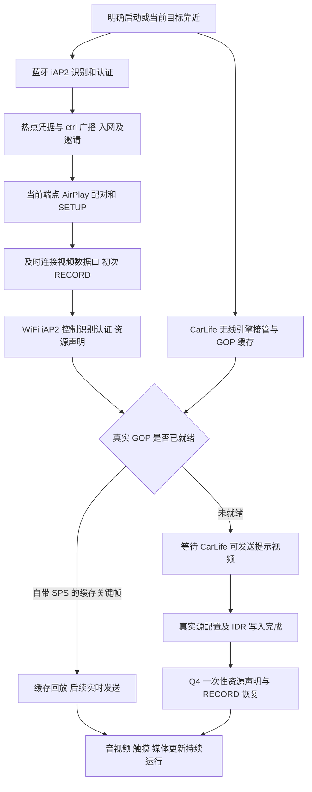

# 奥迪 Q4 e-tron CarPlay 交互链反推与实验记录

更新日期：2026-11-09。本文件服务于 `codex/audi-q4-etron` 的专用适配，作为后续连接实验的持续交接记录。描述的是本车已观察到的行为与应用策略，不将其他车型的时序要求直接推广到 Q4，也不把推断写成车机固件规范。

## 证据基线与可信程度

| 编号 | 材料 | 可以支持的结论 |
| --- | --- | --- |
| E1 | [2026-11-08 19:11 实车分析](vehicle-tests/2026-11-08-q4-191143/analysis.md)，应用代码 ca2066f | 用户确认自动连接、音视频和封面成功；CarLife 兜底进度当时存在映射回归；包含各建链阶段的详细计时 |
| E2 | [2026-11-09 00:33 实车交接](vehicle-tests/2026-11-09-q4-003324/analysis.md)，应用代码 562b24f2db53 | 多次连接、48K PCM 输入/发送、封面成功回执及进度递增；暴露离车收尾后 Activity 初始化重新启动连接的问题 |
| E3 | 今早 `CarPToCarL-log-20261109-073024(1).txt`，应用代码 562b24f2db53，schema 20261108-v9，手机 Android SDK 36 | 两次晚到 CarLife 视频失败，第三次较早获得真实关键帧后稳定运行；用户提供启动操作顺序的补充说明 |
| E4 | b2930de 源码及本次 Q4 首帧恢复修复 | 可以证明实际调用路径、门禁和本机测试行为；不证明修复后的车机表现 |

E3 原文件 SHA-256：`57228f81b996dfa51d94b40b7392e9ad61be8e8e8ea55a4291488c7bed5630d8`。原始日志不入库；此处只保留必要的时间、计数和消息类型，不保留车辆名称、MAC、SSID、IP、设备标识或协议原始负载。导出由早期诊断、近期诊断和有限主日志组成，有重复和轮转；同毫秒事件次序及未保留的日志不能作为严格因果或“从未发生”的证据。

下面将“已观察事实”“解释假设”“当前应用策略”分别标明。`write/txAccepted` 是本地写入被接受；RTSP 200 是请求成功；文件 SUCCESS 是接收端文件处理成功。它们都不等于车机视频已解码或页面已显示。

## 已观察到的能力

- 本车屏幕画布为 1412×654，SETUP 通告 60fps。编码尺寸应由真实 SPS 确认，显示视口与解码尺寸独立，不能靠写死 VideoConfig 尺寸修正不匹配的码流。
- E3 蓝牙 SYN 声明控制会话和 EA 会话，没有文件会话；WiFi iAP2 隧道则声明控制、文件 v1、EA 会话。WiFi 样本的文件会话为 ID 2、maxLength=2048，peerWindow=5、本机声明窗口=127。这些是观测值，发送必须继续采用每轮协商结果，不能将其硬编码为所有连接的固定值。
- E2/E3 媒体流使用已声明的 48kHz PCM；本轮失败并未协商成 AAC。E3 两次早期失败时没有真实音频输入，存在静音保活发送；不能把失败归因于音乐重编码。
- 封面字段为媒体组属性 26，经 WiFi 文件会话传输。E1 用户确认封面显示，E2 收到四次 SUCCESS，耗时约 3～5 秒。早期“蓝牙无文件会话，所以整车不支持封面”的推断已被后续 WiFi 证据否定。
- 当前适配以单指触摸为基线。HUD 有订阅响应和启动命令发送证据，但缺少实际导航 HUD 数据；不能据此断言采集成功或车机不支持导航回传。
- E3 没有提供可用的车机收帧统计。普通 iAPSendMessage/HID/changeModes 事件数量不能替代解码统计。

## 连接链与各阶段的含义

图中是应用逻辑关系，不代表所有步骤严格串行。音频 SETUP、发现广播、CarLife 准备可以与部分控制协商并行。不能将重叠时间相加宣称固定建链耗时。

### 蓝牙 凭据与入网

**事实：**本车会建立蓝牙 iAP2，应用识别车机并完成 MFi 交互，再经 0x5702/0x5703 获取热点配置，处理 0x4300/0x4301 端点信息和 ctrl 邀请。不同轮次端点或邀请可能晚到。E1 有 20B 挑战成功、早期失败误导候选选择的分析；不能把每次传输断开都解释为挑战长度不兼容。

**策略：**保留有效身份、凭据和邀请的代次及过期条件。隐藏 SSID 时，兜底 WiFi 必须具备当前目标的邀请和精确接口证据；系统有 WiFi 不代表它就是车机网络。蓝牙结束不直接证明仍在工作的 WiFi CarPlay 应被拆掉。

### AirPlay 屏幕通道与控制就绪

**事实：**E3 三轮都完成配对、SETUP 和 RECORD。之后才发生提示视频、真实源接管、背压等差异，因此“CarPlay 配对完成”不等于“真实 CarLife 已可用”。E1 分析表明首次 RECORD、WiFi 控制识别认证、主屏资源声明等阶段需要分开计时。

**策略：**视频数据口仍及时连接，不为了等本地引擎而无限阻塞车机的建链窗口。保留控制就绪门禁及已有初始激活行为。当前修复不改 SETUP 次序、不缩短协议超时、不增加屏幕流重建。

### 两种源启动顺序

**CarLife 先启动，CarPlay 后连接：**已有 GOP 的首帧必须是自带 SPS 的关键帧，才沿 FirstFramePolicy 回放。回放完成后开放实时路径。该路径没有经历等待/提示切换且缓存写出成功时，不额外武装本次首帧恢复；保留原本的缓存起播、初始化 RECORD、音频加入行为及既有编码器 IDR 请求。不能因为后续普通 IDR 到达而再次激活屏幕。

**CarPlay 先连接，CarLife 晚启动：**没有可用缓存 GOP 时武装等待源恢复。提示帧只是另一套本地 H.264 源，不可将提示配置或提示 IDR 当作真实 CarLife 成功。真实源接管必须先写出其配置及 IDR；P 帧、队列接纳、提示重发均不触发恢复。

**CarLife 在已有投屏期间重建：**沿既有 source restart 清配置、等新 IDR；旧源的排队恢复作废。新源真实关键帧写完后最多执行一次恢复。保持帧加密计数连续，不因源重建复用 nonce。

## E3 冷车现场的三轮对照

| 轮次 | 屏幕时序 | 后续可确认的事件 |
| --- | --- | --- |
| 失败 1 | 06:48:24.094 首次 RECORD；27.895 提示；30.305 真实首帧写出 | 32.668 见 screen native 资源请求；队列丢帧增多；42.517 控制读取异常结束；44.308 视频局部恢复耗尽，随后停止所属 CarLife |
| 失败 2 | 06:48:51.517 RECORD；55.179 提示；06:49:25.702 真实首帧写出 | 27.980 再见 screen native 请求；38.264 写阻塞 4236ms，关闭所属 socket；40.395 局部恢复耗尽。此时 CarLife 仍有 509 帧输入、最后帧龄约 33ms |
| 成功 3 | 06:49:50.576 首次 RECORD；52.904 CarLife 首帧；52.921 RECORD；52.930 回放 3 帧缓存 GOP | 继续稳定输出约 40 分钟；早期仍有丢帧，但不能将短时队列恢复直接等同于会话失败 |

用户补充：前两次是手动启动 CarLife 后短暂出画面再断开；最后将车机 CarPlay 发起与手机 CarLife 启动时间拉近后成功。日志中的握手/首帧可支持时序差异，但没有精确记录每次点击时刻，不能倒推出精确的人为操作间隔。

### 可以确认的代码缺陷

b2930de 的 SessionController 安装媒体桥时，将首帧恢复整体关闭以迁就宝马。CarLifeHijack 仍打印“通知上层补发 RECORD”，但可空回调没有接线。两次失败真实首帧后没有与该恢复对应的 RECORD 完成记录。源码足以证明原回调未执行；不能仅凭这条旧日志声称已恢复屏幕。

### 解释假设与边界

- **H1，优先验证：**Q4 在经历无真实画面/提示流后，需要在真实源就绪时重新仲裁主屏。缺失恢复与两次晚到首帧失败相关；缓存真实帧早起播的成功轮次支持该方向。补回恢复是否足以解决全部故障，须新包实车对照。
- **H2，未证实：**提示与真实码流的配置切换可能参与车机解码器退回 native。早期详细 SPS/配置日志不足，不能断言某组 SPS 错误、分辨率错误或车机某个内部阈值被触发。其他固件分析中的 badFramesThreshold 数字不能直接当作本车测量值。
- **H3，已见故障阶段但未确定上游原因：**真实源仍持续输入，下游写阻塞和数据口恢复耗尽导致应用终态清理。阻塞可能与车机消费/资源状态或无线、系统调度有关；现有日志不能排除这些因素。
- screen native 是资源请求证据，不是单独的错误码。没有车机解码统计，不能据此直接证明解码失败或车机固件 bug。

## 本次修复的应用契约

修复提交：[78ed563](https://github.com/WHCMrShi/CarPToCarL/commit/78ed563)。Q4 分支优先，覆盖此前“宝马不补 RECORD”对本车型的全局限制，不新增车型识别开关。

- 恢复状态属于每个 VideoSender；等待源、成功写出的提示视频、source restart 或缓存 GOP 一帧也未送出时才武装。缓存 GOP 正常起播不武装。
- 等待接管时，真实 IDR 必须具备写成功的配置；提示 config 不足以通过门禁。实际提交/发送路径报告完成，入队结果不作为写成功。
- 发出一次带源代次的恢复通知，在后台按 assertModes → RECORD 顺序执行；源代次、连接/建链工作凭证、当前 client/video owner 和控制连接有效性均参与检查。网络 IO 不持有恢复状态锁，也不在视频线程执行。
- 普通后续 IDR、旧源通知、旧连接通知、退役 owner、重复任务不重复激活。assertModes 失败不继续 RECORD；该源不无限重试，新源可获得新机会。
- Q4-HANDOVER 日志区分 queued、ACTIVATED、STALE、MODES_FAILED、RECORD_FAILED 和异常。ACTIVATED 只表示本轮两个控制请求成功，仍不等于确认车机已显示。
- 不修改音频、触摸、网络身份校验、离车预算、队列大小、已有数据口重试、版本号；不新增屏幕 SETUP 重建。Android 时钟默认不变，注入时钟仅用于 JVM 视频路径测试。

本机验证：`scripts/build-local.ps1 -Tasks @(':app:testDebugUnitTest', ':app:lintDebug') -NoDaemon`，787 项 JVM 单测通过，0 failures / 0 errors；lint 0 errors / 95 warnings，沿用既有 baseline（另过滤 3 errors / 94 warnings）。新增 12 项涵盖缓存先起、晚到源、异步写完成、源重建、配置门禁、过期/外来恢复通知、网络执行期间代次替换、一次性失败处理与加密帧计数。

未构建 APK、未安装、未实车；脚本末尾打印的是此前已有 APK 路径，未执行 assemble/package APK 任务。恢复失败后的新层级处理应另立实验，不在这一补丁中混入。

## 后续实验更新规则

每次连接实验同步更新本文件：增加实验条目，将新事实关联到 E/H 编号；遇到反例要降低或撤销原假设，保留原判断变迁，不能只追加成功结论。用户操作反馈与日志事实分别记录。

每条至少包含：源码提交、诊断 schema、应用版本、手机/车机环境、启动先后顺序、冷/热车、用户操作、证据源摘要、关键时间线、成功/失败判据、反例、剩余不确定性。原始日志不入库；归档摘要或节选时去掉身份、地址及完整协议负载。

重点观测：

1. CarLife 提前就绪、同一时间就绪、晚 5/30/60 秒就绪，均独立测试。
2. 标记等待/提示发生、真实配置、真实 IDR 写完、Q4 恢复排队、资源请求/RECORD 结果、首段稳定输出的时间。
3. 提示已发送后取消、快速重新连接、等待恢复时源重建、assertModes 过程中断线；确认旧通知不能激活新会话。
4. 成功应同时考虑用户可见画面、持续输出和控制连接；本地 write、短暂一帧、事件计数均不足以单独宣称恢复。
5. 记录视频队列丢弃、等待 IDR、写阻塞、控制结束与最终清理的先后；不要通过无限延长超时或扩大缓存掩盖背压。

## 未在本次修复的待办

离车自动停止后 Activity 初始化重新武装连接、首次热点凭据等待、音频连续性，以及必要时建立 Q4 屏幕流级恢复，仍各自独立评估。保留 E2 的优先级与证据边界；家庭 WiFi 活动不能仅凭地址或默认网络变化归咎于应用主动连接。

## 变更记录

| 日期 | 实验/变更 | 状态 |
| --- | --- | --- |
| 2026-11-09 | 整合 E1/E2/E3，反推 Q4 控制链与两种源启动顺序 | 初始证据模型；H1/H2 尚待新版本实车验证 |
| 2026-11-09 | [78ed563](https://github.com/WHCMrShi/CarPToCarL/commit/78ed563)：恢复晚到源接管门禁及回调 | 本机测试结果见该提交；未构建 APK，未实车 |
