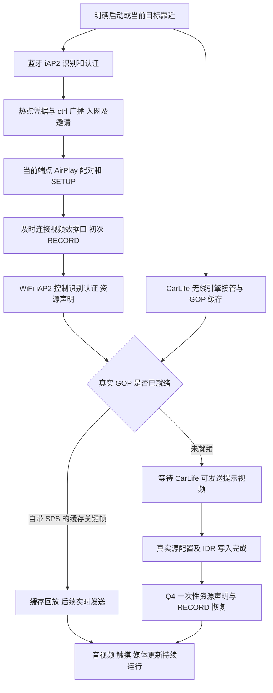

# 奥迪 Q4 e-tron CarPlay 交互链反推与实验记录

更新日期：2026-11-13。本文件服务于 `codex/audi-q4-etron` 的专用适配，作为后续连接实验的持续交接记录。描述的是本车已观察到的行为与应用策略，不将其他车型的时序要求直接推广到 Q4，也不把推断写成车机固件规范。

## 2026-11-13：disableBluetooth 最小协议实验

开发基线 `76994afa0d82`。本节与实现处于同一独立提交，提交主题为 `feat(carplay): send disableBluetooth after session activation`。用户明确安排先让 CarLife 连接，再到车上测试；本次是补齐标准协议命令的最小实验，不作为已有连接故障的修复。

依据用户提供的 CarPlay 规范（2015-12-18版）§23.3.7、§23.3.7.3（印刷页477–479）：手机经 Controller 控制连接发送 `POST /command`，二进制plist顶层为 `type=disableBluetooth`、`deviceID=手机蓝牙MAC`；车机应在收到后立即断开该手机的HFP/A2DP/AVRCP，并在CarPlay会话期间不重连这些profiles。§23.2.5.5及图23-3把蓝牙断开安排在CarPlay/iAP2 over CarPlay启动后；没有在这些条款中给出手机发送的毫秒时限。现有Q4归档在2026-11-05及2026-11-09的 `/info` 中已有 `bluetoothIDs` 声明，但没有本次命令执行后的实车证据。

实施限定：在原有初次激活及Wi-Fi iAP2等待流程结束后，最近一次激活RECORD成功、Wi-Fi iAP2就绪、当前会话有效时，异步发送一次。地址固定使用本次初始SETUP的本机地址；车机未声明有效 `bluetoothIDs`、本机地址无效/占位或节点未就绪时记录跳过。未就绪后不新增定时等待或补发；失败不重试。请求使用既有控制通道加密、CSeq响应派发、10秒请求超时和连接资源作用域；旧会话排队请求不能转到新控制连接。并发执行不延迟原有首帧/音频启动等待流程。

不增加CarLife连接门禁，不改本机蓝牙总开关、HFP/A2DP协调器、现有入站/出站恢复与退避，也不新增“预期BT关闭”仲裁。`BT-DISABLE`记录请求、响应或跳过原因并进入诊断归档；`accepted=true`仅表示协议200响应，不代表已观察到profile/ACL断开。若车机关闭BT后旧恢复策略补拨，保留该行为作为本次实测证据，再单独决定是否调整。

两种启动顺序：CarLife先起是本次用户计划采用的实车路径；CarPlay先起仍会直接发送，不等待CarLife，这条路径可能影响后续CarLife拉起，尚未验证。CarLife是否在蓝牙断开后持续出帧、音频和控制是否维持，均留待用户上车测试；本机安装不能证明这些结果。

本机验证：`build-local.ps1 -NoDaemon` 的174个套件、1003项JVM单测全部通过（0 failures/errors/skipped），其中新增6项socket回归；lint 0 errors、105 warnings、2 information，Debug APK构建通过。手机安装状态以交付回复为准；未做Q4实车验证。用户明确本次与前面的连接状态/释放协调提交一起测试，不适合时单独revert本次命令提交。

## 2026-11-13：统一配置文件释放与拨号（第一步）

用户明确授权只实施这一项。开发基线 `150bf977d5a6`，代码提交 `5a9ccfc3e92b`；文档单独提交。本节没有新增实车样本，不将该协调器描述为 iPhone 内部实现，也不推断 Q4 的拒绝原因。

### 判断依据与改动边界

| 判断或行为 | 依据 | 本次实施 |
| --- | --- | --- |
| 查询不到状态不能等同离线 | [Android BluetoothProfile 文档](https://developer.android.com/reference/android/bluetooth/BluetoothProfile)明确连接设备列表在错误时也可为空；原 `connectedNames` 又将缺失代理/异常合并成空列表 | 改用每个 profile 的状态查询。应用可观察到的代理缺失、异常或非预期值记 `UNKNOWN`；保留系统四个连接状态，不把 `CONNECTING`/`DISCONNECTING` 合并为断开 |
| 请求被接受与断开完成是不同事件 | [AOSP BluetoothA2dp.disconnect](https://android.googlesource.com/platform/packages/modules/Bluetooth/+/refs/heads/main/framework/java/android/bluetooth/BluetoothA2dp.java)说明返回值与后续状态变化的关系；旧代码丢弃了反射返回的 Boolean | 分别记录请求 `ACCEPTED`/`REJECTED`/`UNKNOWN` 和前后观测状态；返回 null、反射失败不再按成功处理；查询报告离线才记 `DISCONNECTED` |
| 本地释放和拨号需要共同串行入口 | 基线 `Iap2BluetoothClient.connectLoop`、`BtProfiles.guardAudioProfiles`、`MainActivity.onBondStateChanged` 可并发执行；RFCOMM owner 要在 connect 返回后才登记，原 owner 复核不能覆盖正在拨号的窗口 | 三个入口使用同一动作租约；出站从 SDP/首次拨号、失败后的释放及重试，一直保留至 owner claim。系统调用和等待不持有协调器的监视器锁 |
| 等待后旧操作不能影响新会话 | 继承 [01336e140f42 的工作/owner 归属修复](vehicle-tests/2026-11-11-q4-171732/implementation.md)；已存在的代次和 owner 语义 | 排队后复核原票据，不重新捕获；停止/换目标/新入站作废旧操作。入站 claim 不排队，关闭回调仅捕获旧出站自己的 socket，旧动作退出前不释放租约 |
| 必须保留双向接续 | [11月11日日志](vehicle-tests/2026-11-11-q4-171732/analysis.md)：16:33:35.391 出站失败后，40.615 已有入站 SYN；[11月10日日志](vehicle-tests/2026-11-10-q4-cold-start/analysis.md)：06:56:36 入站协商超时，38.334 出站建立并随后取得凭据 | 入站监听、出站恢复、被动等待及16/20/30秒退避继续保留，没有缩短协商超时或新增方向切换条件 |
| 设备级兜底不因未知状态而扩大 | 基线已有 profile 等待1500ms、设备级 disconnect 与后续500ms等待；原 owner 规则禁止活跃RFCOMM期间设备级断开 | 只在复查明确仍为 `CONNECTED` 且原 owner/工作票据允许时沿用旧兜底；未知/过渡态本身不授权它。该旧策略的必要性并未被本次实车重新证明，没有新增兜底或延长等待 |

`BtActionCoordinator` 的租约用于本地动作互斥，`BtProfileOperation` 继续负责工作和会话归属；没有另加车机状态猜测、失败次数阈值或自动修复分支。保留先直连、失败才释放并再拨的策略；有界等待后，即使仍在线或未知，也沿原策略继续有效的第二次拨号，不用“已断开”作为重试成功的前提描述。`disableBluetooth`、默认配置、版本号和音视频策略均未修改。

### 日志语义与仍然存在的边界

`BT-ACTION` 以动作 ID、来源、阶段和拨号耗时关联操作；`BT-RELEASE` 分开记录 `before`、`requests`、`after`、`deviceRequest` 和 `superseded`。守卫计数为释放尝试轮数（包含请求结果未知），不是实际断开次数。成功提交和查询状态不互相覆盖，排队期间已失效的操作不再发请求。新增动作/释放日志及关联的 owner/守卫日志加入既有诊断归档白名单，轮转测试覆盖它们不会随主日志轮转丢失；原始协议负载仍排除。

`DISCONNECTED` 表示 Android 状态查询报告离线，不是 HCI/空口抓包确认。上述 AOSP A2DP 实现内部还可能在服务不可用/RemoteException 时返回默认离线，应用无法仅凭这一返回值识别所有系统内部错误；本次没有为猜测的系统内部故障增加额外兜底。系统已接受的异步请求不能撤回，复核到系统调用之间仍有极短竞争窗口。因此本次只保证本地释放流程和出站拨号不由三个入口并行启动，不保证所有物理蓝牙事件完全不重叠，也不保证省掉16秒或改善首次开窗。

### 本机验证与后续对照

完整 `build-local.ps1 -NoDaemon` 通过（3分8秒）：173个套件、997项JVM单测，0 failures/errors/skipped；lint 0 errors、105 warnings、2 information；Debug APK构建通过。新增19项状态语义和并发回归，更新原操作归属测试及诊断轮转测试。构建发生在代码提交前，业务源码树对应本节记录的代码提交，APK内源码标记为 `150bf977d5a6-dirty`。没有执行Android设备测试或安装。

静态复核：CarLife先起仍沿原源缓存/首次播放路径；CarPlay先连仍沿原提示与真实源接管路径。本次不修改两者的启动先后、媒体交接或退避。两条路径都尚未安装和Q4路测，不能把JVM并发测试或APK生成当作车机验证。

后续同一新包分别记录冷/热车、CarLife先起和CarPlay先连：对照动作ID中的拨号与释放阶段、请求返回和后续状态、入站owner接管及失败后出站接续。日志事实仍不足时先补证据，不增加推测性判断或恢复分支。

## 2026-11-11 17:17 正常样本：首次退避与PCM审查

详见[连接时间线与48K PCM全链路Review](vehicle-tests/2026-11-11-q4-171732/analysis.md)，附三类去重数值CSV。日志源码28198990af96与Review基线95955bea856f的app树一致；schema 20261108-v9，用户反馈总体正常、首次上车总见16秒重试。此份材料只覆盖一次CarLife先起：16:33:30握手、32.882真实首帧，CarPlay在57.484写首帧、58.372完成音频加入后RECORD，距连接开始分别27.573s/28.461s；不能以较晚开始的“本轮11.9s”代替完整等待。

35.391出站socket失败后，本机16/20/30秒阶梯进入首档；40.615已见BT SYN，45.718取得凭据，51.277配对成功，均在预计16秒到期前。末尾会话摘要确认成功方向是inbound。16秒来自旧固件移除设备冷却的兼容策略，不是本次车机要求退避，也不是本次已证实可省16秒。HFP/A2DP在线、释放后入站推进支持进一步测量配置文件释放与双向拨号仲裁，但泛化socket错误不能证明车机内部拒绝原因。历史E8入站超时仍需出站接续的反例保留；不取消出站或全局降低冷却。

本轮已复用目标Wi-Fi、由mDNS获得端点并直接推进；首次配对“重试#1”实为每轮首次钩子，不证明曾配对失败。三次RECORD分别对应初始激活、Wi-Fi控制就绪和音频加入；正常样本不证明其中任何一次可直接删除。缓存48帧完整写出后保留编码器。CarPlay先连/CarLife晚到没有本轮新样本，继续保留原提示/真实源接管与静音保活契约。

48K PCM会话持续约42分47秒，输出349619包；去重汇总有69块输入被队列淘汰，发送最大间隔394ms、worker最大553.693ms，sender锁等待最高1.867ms。用户“总体正常”与局部抖动并不矛盾；窗口峰值不是逐包分布或CPU时间。当前已有固定PCM组帧及加密/UDP工作区复用，不再把旧复制缺陷当现存问题。剩余队列copy/集合分配可独立优化；250ms为本机协商下限，不能当实测声学延迟，降低需单独A/B。controlPort=0，本轮无音频RTP同步线程，不能将其他timing/feedback或静音线程混为一谈。末尾整栈断开无准确用户动作时刻，不定性为自发故障。

本次日志分析阶段仅更新证据与文档，没有业务变更。验证结果及优化优先级见报告；后续实施记录见下文，没有新增安装或Q4路测。

用户后续选定研究“统一HFP/A2DP释放与拨号仲裁、有效邀请后的同网公告去重、音频CPU优化”，经独立Review后明确只实施蓝牙旧操作竞态修复及音频队列增量计数。[方案优先级](vehicle-tests/2026-11-11-q4-171732/optimization-proposal.md)已据此修正，其余工作暂缓。源码分别为`01336e140f42`与`5e9744e`，详见[实施与验证记录](vehicle-tests/2026-11-11-q4-171732/implementation.md)。蓝牙等待前捕获的工作/owner票据贯穿配置释放与重试，阻止新会话出现后旧操作继续推进；保留同一未就绪owner的配置级释放，活跃RFCOMM owner期间不做设备级disconnect兜底。已提交的Android操作及复核后的极短系统调用间隙仍无法撤销，不宣称消除一切空口重叠。音频只替换队列预算统计方式，保留FIFO、预算及gap语义；没有CPU实测收益或缩短16秒的结论。

本次未改变CarLife先启动与CarPlay先连接的媒体交接顺序，也未改变退避、邀请公告、静音保活或默认配置。历史入站失败需出站接续的反例仍约束后续设计。完整本机构建通过：1002项JVM单测，0 failures/errors/skipped；lint 0 errors、97项既有warnings；Debug APK通过。没有新增两条启动路径的实车证据，安装与Q4路测仍待开展。

## 2026-11-11 回退后的当前入口

`073bd2aac568` 已完整撤销 `44e66eb` 至 `2fe2802` 的 19 个提交，恢复到 `489d74b` 的树，然后只重写非音频缺口。当前源码、审查结论、新日志证据、两种启动顺序、验证边界与换电脑步骤集中在 [回退与非音频修复交接](vehicle-tests/2026-11-11-rollback-non-audio/handover.md)。下文旧实验记录保留其历史语境，不替代这份最新交接。

新证据否定“同会话重建 AAC 失败仍能保住旧流/视频”的保证；该实验已撤销。23:19:13 蓝牙代理等待中断是独立可定位的崩溃缺陷，本次修复取消传播并重写崩溃持久化。热点旧 suggestion 清理成功后仍有默认未验证 WiFi 的反例，所以清理只是一项必要策略，不能宣称所有断网已解决。23 点材料同时存在 CarLife 先起和 CarPlay 先连路径，后者也确有迟到首帧，尚无 Car+ 封锁的充分证据。当前新代码仅本机验证，未安装、未路测。

## 证据基线与可信程度

| 编号 | 材料 | 可以支持的结论 |
| --- | --- | --- |
| E1 | [2026-11-08 19:11 实车分析](vehicle-tests/2026-11-08-q4-191143/analysis.md)，应用代码 ca2066f | 用户确认自动连接、音视频和封面成功；CarLife 兜底进度当时存在映射回归；包含各建链阶段的详细计时 |
| E2 | [2026-11-09 00:33 实车交接](vehicle-tests/2026-11-09-q4-003324/analysis.md)，应用代码 562b24f2db53 | 多次连接、48K PCM 输入/发送、封面成功回执及进度递增；暴露离车收尾后 Activity 初始化重新启动连接的问题 |
| E3 | 今早 `CarPToCarL-log-20261109-073024(1).txt`，应用代码 562b24f2db53，schema 20261108-v9，手机 Android SDK 36 | 两次晚到 CarLife 视频失败，第三次较早获得真实关键帧后稳定运行；用户提供启动操作顺序的补充说明 |
| E4 | b2930de 源码及本次 Q4 首帧恢复修复 | 可以证明实际调用路径、门禁和本机测试行为；不证明修复后的车机表现 |
| E5 | [2026-11-09 15:15 实车分析](vehicle-tests/2026-11-09-q4-151539/analysis.md)，源码 7377d8e2ec3c | 网络失效缓存复用、两次晚到源在恢复返回成功后仍失败；缓存起播成功对照及主动离车确认；首次实际TBT/PNG数据 |

E3 原文件 SHA-256：`57228f81b996dfa51d94b40b7392e9ad61be8e8e8ea55a4291488c7bed5630d8`。原始日志不入库；此处只保留必要的时间、计数和消息类型，不保留车辆名称、MAC、SSID、IP、设备标识或协议原始负载。导出由早期诊断、近期诊断和有限主日志组成，有重复和轮转；同毫秒事件次序及未保留的日志不能作为严格因果或“从未发生”的证据。

下面将“已观察事实”“解释假设”“当前应用策略”分别标明。`write/txAccepted` 是本地写入被接受；RTSP 200 是请求成功；文件 SUCCESS 是接收端文件处理成功。它们都不等于车机视频已解码或页面已显示。

## 已观察到的能力

- 本车屏幕画布为 1412×654，SETUP 通告 60fps。编码尺寸应由真实 SPS 确认，显示视口与解码尺寸独立，不能靠写死 VideoConfig 尺寸修正不匹配的码流。
- E3 蓝牙 SYN 声明控制会话和 EA 会话，没有文件会话；WiFi iAP2 隧道则声明控制、文件 v1、EA 会话。WiFi 样本的文件会话为 ID 2、maxLength=2048，peerWindow=5、本机声明窗口=127。这些是观测值，发送必须继续采用每轮协商结果，不能将其硬编码为所有连接的固定值。
- E2/E3 媒体流使用已声明的 48kHz PCM；本轮失败并未协商成 AAC。E3 两次早期失败时没有真实音频输入，存在静音保活发送；不能把失败归因于音乐重编码。
- 封面字段为媒体组属性 26，经 WiFi 文件会话传输。E1 用户确认封面显示，E2 收到四次 SUCCESS，耗时约 3～5 秒。早期“蓝牙无文件会话，所以整车不支持封面”的推断已被后续 WiFi 证据否定。
- 当前适配以单指触摸为基线。E3 的 HUD 只有订阅响应和启动发送证据；E5 已实际收到12条可解析的 NEXT_TURN（道路、距离字段和PNG图标），证明该运行方式下 OPPO Car+ 可导出TBT。assistant仍为0；当前只观测，未桥接到车机仪表。
- E3 没有提供可用的车机收帧统计。普通 iAPSendMessage/HID/changeModes 事件数量不能替代解码统计。

## 连接链与各阶段的含义

图中是应用逻辑关系，不代表所有步骤严格串行。音频 SETUP、发现广播、CarLife 准备可以与部分控制协商并行。不能将重叠时间相加宣称固定建链耗时。

### 蓝牙 凭据与入网

**事实：**本车会建立蓝牙 iAP2，应用识别车机并完成 MFi 交互，再经 0x5702/0x5703 获取热点配置，处理 0x4300/0x4301 端点信息和 ctrl 邀请。不同轮次端点或邀请可能晚到。E1 有 20B 挑战成功、早期失败误导候选选择的分析；不能把每次传输断开都解释为挑战长度不兼容。

**策略：**保留有效身份、凭据和邀请的代次及过期条件。隐藏 SSID 时，兜底 WiFi 必须具备当前目标的邀请和精确接口证据；系统有 WiFi 不代表它就是车机网络。蓝牙结束不直接证明仍在工作的 WiFi CarPlay 应被拆掉。

### AirPlay 屏幕通道与控制就绪

**事实：**E3 三轮都完成配对、SETUP 和 RECORD。之后才发生提示视频、真实源接管、背压等差异，因此“CarPlay 配对完成”不等于“真实 CarLife 已可用”。E1 分析表明首次 RECORD、WiFi 控制识别认证、主屏资源声明等阶段需要分开计时。

**策略：**视频数据口仍及时连接，不为了等本地引擎而无限阻塞车机的建链窗口。保留控制就绪门禁及已有初始激活行为。当前修复不改 SETUP 次序、不缩短协议超时、不增加屏幕流重建。

### 两种源启动顺序

**CarLife 先启动，CarPlay 后连接：**已有 GOP 的首帧必须是自带 SPS 的关键帧，才沿 FirstFramePolicy 回放。回放完成后开放实时路径。该路径没有经历等待/提示切换且缓存写出成功时，不额外武装本次首帧恢复；保留原本的缓存起播、初始化 RECORD、音频加入行为及既有编码器 IDR 请求。不能因为后续普通 IDR 到达而再次激活屏幕。

**CarPlay 先连接，CarLife 晚启动：**没有可用缓存 GOP 时武装等待源恢复。提示帧只是另一套本地 H.264 源，不可将提示配置或提示 IDR 当作真实 CarLife 成功。真实源接管必须先写出其配置及 IDR；P 帧、队列接纳、提示重发均不触发恢复。

**CarLife 在已有投屏期间重建：**沿既有 source restart 清配置、等新 IDR；旧源的排队恢复作废。新源真实关键帧写完后最多执行一次恢复。保持帧加密计数连续，不因源重建复用 nonce。

## E3 冷车现场的三轮对照

| 轮次 | 屏幕时序 | 后续可确认的事件 |
| --- | --- | --- |
| 失败 1 | 06:48:24.094 首次 RECORD；27.895 提示；30.305 真实首帧写出 | 32.668 见 screen native 资源请求；队列丢帧增多；42.517 控制读取异常结束；44.308 视频局部恢复耗尽，随后停止所属 CarLife |
| 失败 2 | 06:48:51.517 RECORD；55.179 提示；06:49:25.702 真实首帧写出 | 27.980 再见 screen native 请求；38.264 写阻塞 4236ms，关闭所属 socket；40.395 局部恢复耗尽。此时 CarLife 仍有 509 帧输入、最后帧龄约 33ms |
| 成功 3 | 06:49:50.576 首次 RECORD；52.904 CarLife 首帧；52.921 RECORD；52.930 回放 3 帧缓存 GOP | 继续稳定输出约 40 分钟；早期仍有丢帧，但不能将短时队列恢复直接等同于会话失败 |

用户补充：前两次是手动启动 CarLife 后短暂出画面再断开；最后将车机 CarPlay 发起与手机 CarLife 启动时间拉近后成功。日志中的握手/首帧可支持时序差异，但没有精确记录每次点击时刻，不能倒推出精确的人为操作间隔。

### 可以确认的代码缺陷

b2930de 的 SessionController 安装媒体桥时，将首帧恢复整体关闭以迁就宝马。CarLifeHijack 仍打印“通知上层补发 RECORD”，但可空回调没有接线。两次失败真实首帧后没有与该恢复对应的 RECORD 完成记录。源码足以证明原回调未执行；不能仅凭这条旧日志声称已恢复屏幕。

### 解释假设与边界

- **H1，优先验证：**Q4 在经历无真实画面/提示流后，需要在真实源就绪时重新仲裁主屏。缺失恢复与两次晚到首帧失败相关；缓存真实帧早起播的成功轮次支持该方向。补回恢复是否足以解决全部故障，须新包实车对照。
- **H2，未证实：**提示与真实码流的配置切换可能参与车机解码器退回 native。早期详细 SPS/配置日志不足，不能断言某组 SPS 错误、分辨率错误或车机某个内部阈值被触发。其他固件分析中的 badFramesThreshold 数字不能直接当作本车测量值。
- **H3，已见故障阶段但未确定上游原因：**真实源仍持续输入，下游写阻塞和数据口恢复耗尽导致应用终态清理。阻塞可能与车机消费/资源状态或无线、系统调度有关；现有日志不能排除这些因素。
- screen native 是资源请求证据，不是单独的错误码。没有车机解码统计，不能据此直接证明解码失败或车机固件 bug。

## 本次修复的应用契约

修复提交：[78ed563](https://github.com/WHCMrShi/CarPToCarL/commit/78ed563)。Q4 分支优先，覆盖此前“宝马不补 RECORD”对本车型的全局限制，不新增车型识别开关。

- 恢复状态属于每个 VideoSender；等待源、成功写出的提示视频、source restart 或缓存 GOP 一帧也未送出时才武装。缓存 GOP 正常起播不武装。
- 等待接管时，真实 IDR 必须具备写成功的配置；提示 config 不足以通过门禁。实际提交/发送路径报告完成，入队结果不作为写成功。
- 发出一次带源代次的恢复通知，在后台按 assertModes → RECORD 顺序执行；源代次、连接/建链工作凭证、当前 client/video owner 和控制连接有效性均参与检查。网络 IO 不持有恢复状态锁，也不在视频线程执行。
- 审核竞态修复（源码基线 68e8787）：源重建开始时先作废旧恢复票据，再等待写入锁清理配置。帧在入队/同步提交时携带恢复代次，异步写后再次校验队列与代次，签发票据时原子比较帧携带的代次；不能让阻塞写出的旧 IDR 领取新源的恢复机会。该修复只调整本地归属门禁，没有新的实车证据。
- 普通后续 IDR、旧源通知、旧连接通知、退役 owner、重复任务不重复激活。assertModes 失败不继续 RECORD；该源不无限重试，新源可获得新机会。
- Q4-HANDOVER 日志区分 queued、ACTIVATED、STALE、MODES_FAILED、RECORD_FAILED 和异常。ACTIVATED 只表示本轮两个控制请求成功，仍不等于确认车机已显示。
- 不修改音频、触摸、网络身份校验、离车预算、队列大小、已有数据口重试、版本号；不新增屏幕 SETUP 重建。Android 时钟默认不变，注入时钟仅用于 JVM 视频路径测试。

本机验证：`scripts/build-local.ps1 -Tasks @(':app:testDebugUnitTest', ':app:lintDebug') -NoDaemon`，787 项 JVM 单测通过，0 failures / 0 errors；lint 0 errors / 95 warnings，沿用既有 baseline（另过滤 3 errors / 94 warnings）。新增 12 项涵盖缓存先起、晚到源、异步写完成、源重建、配置门禁、过期/外来恢复通知、网络执行期间代次替换、一次性失败处理与加密帧计数。

未构建 APK、未安装、未实车；脚本末尾打印的是此前已有 APK 路径，未执行 assemble/package APK 任务。恢复失败后的新层级处理应另立实验，不在这一补丁中混入。

## 后续实验更新规则

每次连接实验同步更新本文件：增加实验条目，将新事实关联到 E/H 编号；遇到反例要降低或撤销原假设，保留原判断变迁，不能只追加成功结论。用户操作反馈与日志事实分别记录。

每条至少包含：源码提交、诊断 schema、应用版本、手机/车机环境、启动先后顺序、冷/热车、用户操作、证据源摘要、关键时间线、成功/失败判据、反例、剩余不确定性。原始日志不入库；归档摘要或节选时去掉身份、地址及完整协议负载。

重点观测：

1. CarLife 提前就绪、同一时间就绪、晚 5/30/60 秒就绪，均独立测试。
2. 标记等待/提示发生、真实配置、真实 IDR 写完、Q4 恢复排队、资源请求/RECORD 结果、首段稳定输出的时间。
3. 提示已发送后取消、快速重新连接、等待恢复时源重建、assertModes 过程中断线；确认旧通知不能激活新会话。
4. 成功应同时考虑用户可见画面、持续输出和控制连接；本地 write、短暂一帧、事件计数均不足以单独宣称恢复。
5. 记录视频队列丢弃、等待 IDR、写阻塞、控制结束与最终清理的先后；不要通过无限延长超时或扩大缓存掩盖背压。

## 未在本次修复的待办

离车自动停止后 Activity 初始化重新武装连接、首次热点凭据等待、音频连续性，以及必要时建立 Q4 屏幕流级恢复，仍各自独立评估。保留 E2 的优先级与证据边界；家庭 WiFi 活动不能仅凭地址或默认网络变化归咎于应用主动连接。

## 变更记录

| 日期 | 实验/变更 | 状态 |
| --- | --- | --- |
| 2026-11-09 | 整合 E1/E2/E3，反推 Q4 控制链与两种源启动顺序 | 初始证据模型；H1/H2 尚待新版本实车验证 |
| 2026-11-09 | [78ed563](https://github.com/WHCMrShi/CarPToCarL/commit/78ed563)：恢复晚到源接管门禁及回调 | 本机测试结果见该提交；未构建 APK，未实车 |

### 源切换竞态的补充验证

新增回归以受控阻塞重现旧 IDR 写到一半时源重建的时序，同时覆盖异步队列与同步提交。验证源失效不用等阻塞写释放、旧完成通知不触发恢复、旧排队票据不能执行控制请求，以及新源配置/IDR 仍能触发一次恢复。测试还保留 CarLife 缓存先起播和帧加密计数连续性检查。本次未构建 APK、未安装、未实车；本次全量 790 项 JVM 单测通过（0 failures / 0 errors），lint 0 errors / 95 warnings，沿用既有 baseline。修复实现及验证对应本节所属提交。

## 2026-11-09 上游 1.2.31 合并复核

代码提交：[1a68b63](https://github.com/WHCMrShi/CarPToCarL/commit/1a68b63)，合入上游 `6a9b40b`；完整取舍与验证见 [合并记录](upstream-main-20261109-q4-merge.md)。

本次是源码适配和本机验证，没有新的实车日志；E1/E2/E3 和 H1/H2/H3 的证据等级不变。
Q4 晚到源接管、早到缓存 GOP 路径、0200e08 的跨源写完成隔离均保留。VideoSender 本体未改；控制侧工作凭证、client/video owner 与 controlAlive 检查仍在。

连接链新增约束：原 specifier 请求在 15 秒未完成时可再等 20 秒，明确不可用或取消立即结束；同 SSID 门禁等待者覆盖完整窗口及建议网络兜底，自动流程不再等待自建重试/删除热点对话框。旧身份凭据、固定网络租约与终态预算不变，不能把加宽等待解释为绕过用户授权或放宽网络身份。

Q4 差异：保留 SPLIT 默认，不自动采用上游 RAW；停摆仅按最后帧龄诊断，恢复默认关闭，显式开启也不强制重建 HU；麦克风上行模块未接入，不改变 PCM 下行 SETUP。

本机 823 项 JVM 单测通过，lint 0 errors / 97 warnings（沿用 baseline），未构建 APK、未安装、未实车。下一轮分别记录 CarLife 先起和 CarPlay 先连；补测关联宽限内完成、取消/快速重连以及晚到源接管。H1 修复有效性仍等待这些实车结果，不因 merge 或单测通过升级为已证实。

## 2026-11-09 RAW 默认声明实验

本节所属独立提交只把 VideoCanvasMode.DEFAULT_MODE 从 SPLIT 改为 RAW，并同步默认策略测试及说明。该提交可整体 revert 回到上一版 SPLIT 默认；它不删除偏好、不修改已保存的 `raw/stream/car`，也不改变源分辨率协商、SPS 优先解码尺寸、H.264 数据、加密、音频或触摸映射。此前的 SPLIT 合并记录属于实验前基线。

RAW 下不传 canvasSize/viewAreaSize，VideoConfig 仍携带码流解码尺寸及原有标志，但显示视口字段留零。车机如何缩放和摆放是本次要验证的假设，不能据此宣称首帧连接或画质问题已经解决。E1/E2/E3 与 H1/H2/H3 的证据等级不变。

安装测试包后，应核对日志 `VideoConfig 画布声明` 为“只声明解码尺寸=码流”，以及实际 config 日志中的“视口=未声明”。如果曾显式保存 `stream` 或 `car`，默认值变更不会覆盖它，不能把仍走旧策略的结果归入 RAW 实验。此前默认值不会在 load 时自动写入偏好，正常未手改配置的安装直接使用新默认。

分别记录 CarLife 先启动与 CarPlay 先连接两条路径；检查提示到真实首帧切换、四角/边缘点击、拖动、画面比例/裁剪/留边、取消后重连、通话及返回投屏后的恢复。尤其对比实际 SPS 与 1412×654 画布不同的场景。若车机默认显示矩形改变，触摸映射未变可能造成点击偏移。

本次没有新增实车证据。APK 用于下一轮实验，不把构建成功或 RTSP 200 记为车机显示成功。

本机验证：`scripts/build-local.ps1 -Tasks @(':app:testDebugUnitTest', ':app:lintDebug') -NoDaemon` 成功；823 项 JVM 单测通过，0 failures / 0 errors / 0 skipped，lint 0 errors / 97 warnings（沿用既有 baseline）。覆盖 RAW 默认、空/未知偏好回退、显式 stream/car 保留、不写视口的头部、SPS 解码尺寸、首帧接管及源代次竞态。提交后从干净工作区执行 assembleDebug，APK 源码标识对应本节所属提交；实际产物校验与交付信息在本次构建回复中提供，未安装及实车验证。

## 2026-11-09 导航模块控制与订阅日志修正

用户补充：实际使用 OPPO Car+，借用 CarLife 协议通道，今早在其界面内使用第三方地图完成导航。此前将数据提供者泛称为 CarLife+ 的记录不意味着使用百度 CarLife+ 内置导航。日志仍只确认 TBT 支持应答，未收到 TBT/辅助诱导数据；不能由此断言 Car+ 不支持导出。

本节所属独立提交仅收窄自动 MODULE_CONTROL：NAVI=2、EDOG=8 无论空闲/活跃都不进入通用自动置 1 的列表；只含导航模块，或只有导航空闲、其他模块均非零时，不发送自动控制。其他模块沿用原批处理策略，显式 moduleControl 的序列化 API 不变，HUD 观察器仍接收原始导航状态。

日志把 START 的 confirmed 改为 supportConfirmed，SUBSCRIBE_DONE 明确只代表能力应答；START 的 sent/startSent 明确仅表示本地写成功，未确认对方激活。保留已有支持判定、START 时序、一次性兜底及计数，不新增重发、frequency、4.0 应答、导航数据桥接或新握手步骤。RAW 默认和此前首帧接管不变。

这是语义修复与观测澄清，不宣称解决 OPPO Car+ 的导航导出；没有新增实车证据。本次测试包供用户上车比较导航模块状态与 TBT 接收计数。

本机验证：全量 828 项 JVM 单测通过（0 failures / 0 errors / 0 skipped），包含 5 项新自动控制测试及订阅日志回归；lint 0 errors / 97 warnings，沿用既有 baseline。测试覆盖 NAVI/EDOG 单独空闲、与活跃/空闲媒体混合、其他模块批处理保持，以及显式导航控制 API 保持。随后从干净提交构建 Debug APK，内嵌源码标识和交付副本由构建步骤校验；尚未安装/实车验证。

## 后续连接优化交接入口

按 [2026-11-09 优化路线](q4-connection-optimization-roadmap-20261109.md) 逐项推进，顺序为 MFi 失败分类、真实关键帧请求、资源仲裁、蓝牙交接空窗、重复等待/重建、静态保活。当前仅 MFi 分类已获修复授权；路线不是同时实施后续事项的授权。CPC 握手研究不改变 Q4 的 E/H 证据等级。

## 2026-11-09 Q4 固定 20B 与冷启动认证兜底

方案入口：[优化路线](q4-connection-optimization-roadmap-20261109.md)。用户确认 Q4 多次实测只接受 20B，允许直接固定；另补充冷车启动可能出现认证失败。后者并不证明所有失败均为 0xAA04，仍区分明确拒绝、静默和传输中断。此前保留多长度探测的建议被此车型决策取代。

本节所属独立实现提交只调整蓝牙和 Wi-Fi iAP2 的 MFi 挑战：固定 20B，不读取历史长度排序，不切换 32/16B。每条链路首次生成随机挑战，最多发送两次；拒绝或 6 秒超时可重传一次原始字节，蓝牙仍受已有会话总截止时间约束。同一逻辑挑战重传使迟到签名不被归给另一份随机挑战；新连接重新生成随机值。

收到本链路 0xAA03 才记录 20B 响应成功，沿用既有不验证证书/签名的行为，不能据此声称新增了密码学验证。任何失败均不改写既有长度记忆，不清理旧存储，也不因为旧成功为 32B 而改变固定 20B。断链立即结束本轮，客户端/服务端已有 finally 和连接恢复继续工作；拒绝/静默重试耗尽也不假发 0xAA05。隧道耗尽后退役该实例，完成或退役后的迟到/重复应答不能再改写记忆或重放成功突发。

本次没有调整 AirPlay 配对、资源仲裁、网络门禁、首帧接管、RAW、PCM 或导航订阅。未实施路线中的后续事项，也未扩展总体恢复预算。最终实车可靠性仍待本次测试包验证，不因本地测试通过提升 H1/H2/H3 的证据等级。

验证：838 项 JVM 单测通过（0 failures / 0 errors / 0 skipped），lint 0 errors / 97 warnings，沿用既有 baseline。新增 7 项真实内存链路回归，覆盖旧长度记忆不干扰固定长度、已知成功/冷启动断链、首次拒绝后恢复、静默重传同字节后的迟到签名、明确拒绝耗尽及总截止时间；隧道新增冷启动恢复、超时/拒绝耗尽、重复/退役响应测试。用户随后要求仅提交、先不构建 APK；已启动的 assembleDebug 在打包前中止，本提交无新 APK 交付，未安装、未实车。后续测试应分别覆盖 CarLife 先起和 CarPlay 先连，并关注认证首次失败后的恢复轮次。

## 路线 2：直通关键帧请求闭环

forceKeyFrame 现在异步转交请求当时的 CarLife HU 和作用域，直接请求 98311 编码初始化，不重复发 98386。VideoSender 以当前源代次合并请求，最多每 6 秒一次，已有命令仍在执行时不新增工作；每次命令前检查源、投屏 owner 和 HU 存活。命令实际写出结果与源 IDR 到达、配置及 IDR 写完分别记为 KEYFRAME-DIAG；本地提示帧不能完成真实源请求。正常到达的 IDR 只能证明请求后的观测，不能单凭它确认与请求的因果关系或车机已显示。源重启/停止作废旧票据，已有晚到源一次性接管保持原契约。

日志的“已强制编码 I 帧”改为请求已提交/合并，不改变音视频格式、缓存起播策略或连接预算。此项新增纯逻辑与真实 VideoSender 路径回归，实车恢复有效性待验证。

## 路线 3：Q4 屏幕与音频资源仲裁

资源枚举核验自 WirelessCarPlay 的 AirPlayCommon.h（51145ef），并与 E3 的 PHONE/PHONE_END、RVC/RVC_END 成对请求对照：resourceID 1/2 为屏幕/音频，entity 1/2 为 controller/accessory，transferType 1/2/3/4 为 take/untake/borrow/unborrow。每个 AirPlay client 独立保存永久意图及按 borrowID 去重的临时借用，屏幕与音频分别响应，嵌套借用须分别归还；未知/不完整项不更改已知状态。

changeModes 在事件线程只更新意图，后台按最新版本合并回复，网络写串行并受 socket/生命周期代次保护；RTSP 200 仅记 transportAccepted，不宣称车机已交屏。requestUI 返回屏幕意图，不清除临时借用，也不强抢音频。

真实首帧恢复在临时借用期间 DEFERRED，归还/返回 UI 后重试同一有效源票据，不消耗一次性恢复机会。为保留此前 Q4 晚到源修复，只允许真实源启动前收到的 screen native take 在该首帧恢复中重新声明；真实源启动后的 native take 保持车机归属，需返回 UI/归还意图才恢复。该区别是当前最小兼容策略，不能据此声称已完全识别用户手动退出与所有车机故障。未停止媒体连接、未改 PCM/RAW，新增资源和恢复门禁回归；未实车。

## 路线 4：蓝牙交接空窗的只读快照

HANDOVER-DIAG 在原 onSenderLinkClosed 各分支记录原决策（KEEP_VIDEO、KEEP_LIVE_SETUP、CANCEL_SETUP、NO_PENDING_SETUP）、单调时钟、邀请代次和未消费邀请年龄、目标/凭据是否已知、缓存网络是否存在、目标网络验证结果、当前 client 标识、控制存活、建链/视频/源状态、取消和工作凭证状态。不输出 SSID/密码/地址；网络验证只读，邀请 peekAge 不消费、不刷新 TTL。

这是回调发生时的当前状态快照，并非回调原始所属链路的证明；邀请年龄空值也可能是已消费/过期。policyWifiReady 缺失保持未知，不把 networkCached 当验证成功。不新增继续机会、不更改取消、预算或重连策略；等实车中出现 Wi-Fi 已验证但控制尚未建立的反例，再决定是否调整门禁。新增邀请观察无副作用与旧代次隔离回归。

## 路线 5：重复等待与重建的观测基线

PATH-DIAG 用单调时钟记录 Wi-Fi 共享等待、复用绑定、specifier 入网、suggestion 兜底、AirPlay 配对、基础/屏幕/音频 SETUP 及 RECORD 的独立尝试次数、阶段耗时和距连接启动的时间。重复 start 不重置观测起点，终态后未完成的旧阶段不写入新轮；没有主动启动轮的工作明确标 active=false。RETURNED 只代表调用返回，NULL/false/THREW 分别记录，不打印返回对象或异常负载。并行/嵌套耗时不得相加作为总连接时长；仍需结合原始 SETUP/首帧日志定位真正关键路径。

ctrl 广播记录复用、强制冷却、注册及既有 1200ms 重试等待和调用耗时；REGISTER_ACCEPTED 仅为本地 start 返回，不是车机已发现服务。视频 attach 记录缓存帧数/字节数、关键帧/SPS、是否选择回放、源末帧年龄及缓存首关键帧年龄（已移除则未知），完成耗时；缓存年龄仅为收到帧后的本地年龄，不是画面生成时间。HU 标识下的重建计数和 reason 区分 attach、首帧看门狗、零交付与停摆恢复；98311 记录去重/尝试、距上次尝试的时间、写入结果，不能将去重字段当作最近成功写入时间。日志进入关键诊断归档，不新增逐帧日志或身份/凭据。

本项仅观测，保留广播冷却、等待上限、初始化去重窗、attach 的立即重建和所有恢复触发条件。两种启动顺序均沿用原策略：CarLife 先起可记录缓存回放及重建；CarPlay 先连仍通过既有晚到源/首帧恢复，不因统计等待源。后续须分别实车比较首次 IDR、配置/IDR 实际写出、倒车/通话资源归还及交接断链快照，才授权裁剪恢复动作；本机验证不提升 E/H 假设的证据等级。

本轮本机验证：863 项 JVM 单测通过（0 failures / 0 errors / 0 skipped），Android lint 0 errors / 97 warnings（沿用既有基线）。新增覆盖关键帧请求合并/限流/源代次、资源独立/临时借用/首帧延后恢复、邀请只读观察，以及计时轮次隔离/原异常传播/并行耗时/归档保留。未执行 assemble/package，既有 APK 未更新，未安装或实车验证；最终路测仍需分别覆盖两种启动顺序、冷启动认证兜底、来电/倒车归还和 forceKeyFrame。

## Review 修复 1：MFi 耗尽传递给所属父会话

Wi-Fi 虚拟 iAP2 两次失败后仍立即退役并忽略迟到响应，同时一次性排队通知所属 socket/resources/生命周期代次。有效通知关闭该控制连接并标记该 client 认证失败；旧连接通知不得关闭新连接。建链中由原 setup finally 退役管线并走既有有界退避；建链收尾后由同一工作/建链票据保护的回调处理，不新增重试次数或清空记忆。两种 CarLife/CarPlay 启动顺序均保留源缓存与现有退役策略，认证失败不会伪造成功。新增实时 TCP 父连接退役/一次通知/旧代通知隔离回归，并扩展原始内存链路耗尽通知断言；实车结果待验证。

## Review 修复 2：关键帧请求共享 HU 初始化去重

源关键帧请求不再强制绕过 98311 去重，而是在源所属后台线程读取同一个 HU 的最近初始化状态。有序模式下不抢在首条初始化之前；近期同参数初始化则合并等待，实际 IDR 到达或 owner/源退役会终止等待，无 IDR 才在安全窗口后发送一次普通 98311。等待总长不超过原 5 秒去重窗，其他既有强制恢复若更新状态也不会无限延长等待；中断保留取消标记。启动、分辨率和原恢复策略不作调整。新增真实 HU 命令输出测试覆盖并发初始化时序、IDR 合并、启动顺序、停源、中断及等待上限；两种启动顺序的实车验证待完成。

## Review 修复 3：延后接管票据与源代次原子化

延后票据由 Q4ScreenHandover 保存，发布时在与 arm/retire 相同的锁内校验 ticket owner、源代次及恢复状态；arm/retire 原子清除票据。VideoSender 不再先检查代次、再向独立 AtomicReference 发布，因此退役线程不能覆盖新源票据，旧完成也不能清除新票据。网络 IO 仍在锁外，资源借用和一次性恢复策略不变。确定性交错回归覆盖“旧线程暂停于发布前 → 新源武装并延后 → 旧线程恢复发布”，并通过真实 VideoSender 路径验证借屏跨源重启后只恢复最新源。无新增实车证据；CarLife 先起和 CarPlay 先连均使用同一源门禁。

本次三个 Review 修复的最终本机验证：879 项 JVM 单测通过（0 failures / 0 errors / 0 skipped），lint 0 errors / 97 warnings（既有基线）。覆盖父会话真实 TCP 退役、迟到失败/成功隔离、普通配对重连监听存续、HU 命令合并/有序首条初始化/取消，以及退役与延后票据发布的确定性交错。认证重试预算仅在控制认证确认成功后重置，启动视频本身不补充预算。三个问题分别提交后从干净源码构建 Debug APK，实际产物标识由构建步骤核验；尚未安装或实车验证。下一轮同时检查两种启动顺序、冷启动认证失败兜底、来电/倒车期间源重启后的资源归还，以及今天上午其余优化的总体表现。

## E5：2026-11-09 下午连接与导航反例

详见 [15:15 实车分析及下一步方案](vehicle-tests/2026-11-09-q4-151539/analysis.md)。用户确认最后一轮连接成功后主动离车，因此15:14:59断链属于预期结束的对照，不是自动断连证据。

E5两次晚到源均已真实写完1412×654配置/IDR，Q4-HANDOVER返回ACTIVATED，随后约2.2秒仍收到screen native并最终视频恢复耗尽。这否定“只补一次首帧assertModes/RECORD即可保证恢复”的充分性；不证明该恢复调用无用，也不将native直接作为解码错误码。两次缓存源先起路径有持续运行对照，提示1280×720到真实1412×654的转换应独立实验，不能伪改真实SPS/VideoConfig尺寸。

已查实的其他缺陷：上层网络快路径只判缓存非空而绕过活性校验，失网后持续ENONET；sendConfigFromNals遗漏sentSps/CSD/旧IDR状态维护，116份相同SPS仍反复报变化；新鲜缓存写出后仍立即attach重建，间隔14.3秒的98311后确认帧率变20。它们应分别修复和验证，尚未据本节修改业务代码。导航实际数据证据将早晨的“采集未证实”更新为“本运行方式已采集TBT”，保留车机仪表输出与协议能力边界。

## E5 修复 1：撤销失效网络与统一复用判断

所有上层网络快路径、共享等待及推流重试均复用同一 owned/live/process-bound 检查，不再以缓存 Network 非空跳过绑定。specifier 的 onUnavailable 在所属请求内撤销已发布绑定、结束结果并拒绝迟到 onAvailable；旧回调不能清除新请求。所属失网通过原网络恢复入口退役该 setup 的旧 sockets，保留 CarLife 温源，网络重绑后沿用已有有界重试；新 setup 接手、用户取消或退役使旧恢复失效。不增加预算，不放宽隐藏SSID身份校验。相关状态回归及全部验证结果在本轮完成时记录，实车效果仍待验证。

## E5 修复 2：配置成功后的状态提交

恢复 VideoConfig 写成功后的 SPS/PPS 指纹、独立 CSD 缓存与旧 IDR 失效维护。同参数不重复配置，SPS或同包PPS变化仍重发；源重启/数据口新流仍按原策略重发。当前输出/源退役的迟到完成不提交指纹或配置成功状态；写失败不更新缓存。提示帧只更新当前输出配置指纹，不写入真实源CSD缓存，不能用提示配置证明真实源就绪。本项不改变RAW、真实SPS尺寸、密钥和帧计数策略。新增实际 VideoSender 输出回归覆盖重复参数、PPS变化、写失败、输入所有权、源退役和同参数源重启。实车是否消除背压和晚到源失败仍待验证，不把减少配置写入当作已确认解码成功。

## E5 修复 3：新鲜缓存写出后保留编码器

仅当原缓存回放策略已通过、所有缓存帧同步写成功、GOP归属与当前HU相同且仍存活、末帧本地年龄≤1秒且首关键帧年龄≤3秒时，省去attach的立即98386/98311重建。按HU独立身份记录GOP来源，未知/混合来源不能省略恢复；这些元数据不改变原回放选择。所有原首帧/源重启/停摆看门狗保留，空缓存、部分写出、源更换和年龄未知走原重建。只将“已写成功”用于本地策略，不宣称车机已解码。两种启动顺序均保留：无源时继续等真实源并恢复，有效温源起播避免不必要降档。新增门禁边界回归，实车确认帧率和可靠性待验证。

## E5 修复 4：Q4 提示视频采用实际1412×654编码

仅为Q4 CarLife直通传入固定提示编码尺寸1412×654，源未知时不再用1280×720构造本地提示。尺寸交给NoticeFrameEncoder实际编码，VideoConfig继续读取编码结果的SPS；真实源仍可声明其真实1280×720等尺寸，绝不冒充1412×654。RAW、不写视口、真实源门禁和一次性接管规则保持。其他VideoSender调用不传覆盖值时沿用原构造尺寸。新增编码入口/实际配置输出回归检查Q4尺寸、真实源SPS优先、迟到提示阻止、编码失败和默认调用兼容。该项是隔离提示到真实源几何变化的实车实验，并未据本机测试宣称已解决E5的screen native；不新增屏幕流重建或无限重激活。

本轮E5四项修复最终本机验证：900项JVM单测通过（0 failures / 0 errors / 0 skipped），Android lint 0 errors / 97 warnings（既有基线）。新增21项回归覆盖请求撤销/迟到回调、SPS/PPS状态与失败提交、缓存起播健康门禁、提示编码尺寸及真实SPS保持。未运行assemble/package APK，原有测试包未更新，未安装和实车验证。网络回调的厂商实际顺序、硬件提示编码器支持及晚到源稳定显示仍需后续车测。本轮没有新增屏幕流重建、导航桥接或无条件资源抢占；四项分别提交便于review和回退。

## E6：2026-11-09 17:21 长时导航样本（分析，未改业务代码）

源码48c78991460d，用户反馈连接到结束正常，临近17点夜间切换时音频卡顿后自愈。去重后NEXT_TURN 867条、解析错误0，action计数1/2/3=12/851/4；turn枚举1/2/3/7/11/24/25/31。字段4/5在全部样本相等，不能声称分别是总路线与路口距离；legacyTime全部null。16:38:23.972导航模块活跃，17:19:17.393空闲，末尾到达带图标随后清空。assistantRx=0。图标仅日志长度/哈希/PNG头，不能还原图片。

16:37:35.376启动，16:38:13.123首帧，约37.7秒；specifier约7.45秒，配对约0.8秒；早期主动BT失败后车机入站成功。新鲜同源GOP起播确实走保留编码器分支；本样本源先起，不验证晚到源提示修复。约43分钟连续投屏，17:21:08整栈断开与用户结束反馈一致，但无确切用户动作时间，不独立推断故障或离车原因。

卡顿集中16:57:59至16:58:14附近：音频消费最高812ms，分窗口丢38/138/97/6块，输出最大间隔1372ms；视频单写662/447ms并同期大量丢帧。之后恢复到约60ms级输出最大间隔，未见重建整轮会话。无显式夜间切换标记、温度/CPU/GC或网络时延证据，不能认定设备性能或主题切换为已证实根因。下一步独立测量消费锁等待、组帧/加密/UDP发送、CPU调度/温度、视频码率突发与无线发送拥塞；不要直接扩大200ms音频缓存或改变48K PCM。

定位持续约1Hz收到PASCD，抽样最后字段随运动变化；本地parsePascd不解析速度/方向，固定无有效位置，onCarLocation因hasPosition=false全部跳过CarLife GPS发送。对比b9417bb到48c7899，NmeaLocation无变更，SessionController上述逻辑无相关改动记录（原始实现0e629a8）。不能据此声称近期撤销了车速转发，也不能证明先前地图同步来自车机。外部DiPlay实现文档把PASCD描述为时间/挡位/轮速m/s，支持独立验证候选车速，但不是本车字段的规范确认。应验证速度单位/挡位/采样时间，并调查CarLife独立车辆速度输入；禁止伪造坐标或发(0,0)补速度。

HUD适配继续按用户明确方向评估转为媒体信息：下一动作/道路/距离可用；应区分实际图标与未知枚举、增量更新、到达/超时清理及原音乐状态恢复，不实施原生导航能力探测或未经授权的桥接。详细提取CSV为本机dist/HUD-20261109-172147.csv（含路线，不入库）。本次仅分析，未构建/安装或推送。

## E6后续：PASCD独立车速公开协议核验

参见 docs/carlife-pascd-speed-research-20261109.md。公开指南/SDK确认独立速度0x1800F（整数km/h）及车辆数据订阅，不需要伪造坐标；本机Car+与高德实际消费仍未证明。Cmd与Data通道的公开实现有分歧，应按目标版本单变量验证，不能照搬注释。当前不新增发送逻辑。

## HUD覆盖复核

参见 docs/carlife-hud-observation-review-20261109.md。确认完整PNG字段运行时已收到但未保留；CSV仅867条NEXT_TURN语义子集，原报文均无1至6之外字段。旧指南action=3是隐藏而非专门到达，turn枚举不直接适用Car+。两类已知HUD订阅均申请，辅助被手机标为不支持；0x1003B仅为较新第三方实现候选缺口，本次累计控制消息统计未见它。仅分析，无新业务变更。

## 导航媒体显示首版（待实车）

53c924f实现用户授权的音乐/导航仪表信息源切换，状态与边界见 docs/q4-navigation-now-playing.md。仅复用现有HUD输入和NowPlaying输出；采用用户确认的重复目的地忽略、距离0结束、暂停百分比时间轴及25=进入隧道。913项JVM单测及lint通过，不打包APK；不将暂停条、emoji或图片实际显示当作已验证。不修改两种启动顺序的连接时序、音频和车速路径。

### 导航媒体 Review 修复与实车包

用户授权后分别提交 f6f6cd7（SHOW 起始距离及同路同向新片段）、e6bafd9（结束保留期间新引导再次结束）、0d9ab0d（已成功相同图片复用 ID 并重传）。没有更改连接顺序、48K PCM 或车速路径。920 项单测、lint 和干净源码 Debug APK 构建通过；尚未安装或实车验证。M3 消除重复成功内容反复耗用新 ID，但仍保留不同内容的 127 次新 ID 分配边界，不将旧版协议允许回收等同于 Q4 缓存行为已验证。详见 docs/vehicle-tests/2026-11-09-navigation-review-fixes/repair-notes.md。

### 21:55:25 实车反例与导航三态实验

0d9ab0db99bf的本次样本去重有21条HUD转向消息，七轮均先action1/25/26，再在结束前发action3/24/1，紧接action3/24/0；没有action2。推翻“/1必为导航开始并含目的地”的假设。成功图片129/130反复传输并收到SUCCESS，支持相同内容ID复用；不证明不同内容共用ID安全。累计控制统计未见0x10031/0x1003B且otherControlRx=0。用户在停车场与隧道驶离场景确认25为“驶离出口”。

本轮连接是CarPlay先连、CarLife源后到，约61.8秒至真实首帧；早期蓝牙退避与网络反复失效为主要等待，第二次GET /info的控制连接关闭不应解释为明确拒绝SETUP。没有据此更改任何连接逻辑，CarLife先起及实际移动的进度仍待验证。

用户确认后以1ad8dacdf27f实施无准备/目的地的三态、冻结导航区间时长、三空格占位及透明画布原尺寸居中。927项单测、lint和APK构建通过；Android像素检查仅编译未执行。透明图片、trim行为和车机显示必须由新包验证，不能根据本机测试宣称通过。完整记录见docs/vehicle-tests/2026-11-09-navigation-transparent/test-build.md。

## E7：23:11:10 / 23:15:29 导出与明日交接

详见[今晚工作与热车故障交接](vehicle-tests/2026-11-09-night-handover/handover.md)，附脱敏连接及HUD/性能选段。两份导出属于同一1ad8dac进程、大量重叠，不能相加当独立样本。用户确认透明PNG与三空格占位在Q4可行；原图实测48×48居中到256，解释图标偏小。当前均为CarLife先起路径，无action2或导航结束包，移动进度/结束计时仍待路测。

新的交接反例：热车23:12:01.782已绑定Wi-Fi、已收到并消费车机邀请，但02.928 BT闭链时控制TCP尚未建立，onSenderLinkClosed走CANCEL_SETUP。相同client随后TCP/SRP/verify成功、keysPresent=true，却因全局取消被退役。“用户已取消”是上层泛化文案，不证明用户取消。CANCEL_SETUP快照在改标志后记录，policyWifiReady=false受取消条件影响，不能当决策前失网证据；pendingInviteAge=null也可能是已消费。需要独立验证当前票据＋正确网络＋近期邀请下的有界TCP前继续机会，并补闭链来源和决策前快照，保持真实失网/离车/显式取消门禁；本次未改代码。

同一热车后续还有独立的7000连续拒绝10次阶段，两次有限0x4e0e＋0x4300叫醒未立即奏效，23:12:48.098新邀请后下一次TCP及配对成功。与用户“车机主动发起后才连上”的反馈一致，但无车机点击精确时间，不能断言自动开窗失败的内部根因已证明，或只修取消即可全部解决。首次连接则在入站BT未获AP凭据、后续出站BT取得凭据后成功，约50.4秒至首帧。两段音频/视频分段均有墙上耗时尖峰，不把seal耗时直接归因为加密CPU成本。927项单测、lint和构建通过，仅文档/证据提交。

## E8：2026-11-10 冷车，停止后接入与入站链路超时

详见[冷启动及昨晚热启动对照](vehicle-tests/2026-11-10-q4-cold-start/analysis.md)。源码1ad8dacdf27f；用户仅在车机点击一次后很快成功，不记得准确点击时间，不能对应到某条BT事件。今早为CarPlay先完成、CarLife后到，昨晚E7两个过程均源先起；保留场景差异，不覆盖E5/E7。

06:49启动后，06:55:36监测到约360秒主线程心跳间断，旧180秒预算到期收尾。FreezeWatch只观察Handler迟到，不足以独立证明整个进程被ROM冻结。监听停止后21ms仍有接收端连入；源码accept返回后缺少running/代次复核，stop仅关闭监听，活动session finally也未按owner清状态。随后约60秒iAP2 awaitReady超时，尚无AP凭据，出站在约1.6秒后建立并取得凭据。该时序支持修复停止/迟到accept/新旧BT会话隔离；缺少链路进度和owner，尚不能断言车机不握手的内部原因或将入站路径整体禁用。

目标邀请06:56:42.974早于有效专属网络绑定11.4秒，中间首次specifier失效，建议网络候选的本地接口与邀请证据不匹配而被拒绝，第二次specifier成功。邀请在TTL内接续，配对约0.3秒完成。不能继承旧接口证明盲绑新网络。今早未见启动7000拒绝或CANCEL_SETUP；这不反驳昨晚已绑定/已消费邀请/TCP前BT关闭导致本地取消，亦不反驳昨晚随后独立端口未开放。

CarPlay先完成SETUP并写提示；CarLife06:57:22握手、25.169真实首帧转发，之后同client持续至07:37:58附近。没有将本地写成功等同视觉确认，不将旧晚到源失败删去。末尾有RVC借屏、RVC_END归还和POPUP借屏；无精确离车操作时间，不归类自动故障。当前日志具备855条去重action2接收证据，仍不等于仪表移动进度视觉验证。

建议先按owner/代次修BT生命周期和TCP前交接取消，恢复后空闲收尾增加最终代次复核，再独立调查自动开窗；不降低目标身份校验、不取消离车预算、不扩大重试或改变20B认证。上述业务修复均未实施。本节为追加证据，历史假设保留其原样本边界。

### E8修复1：蓝牙监听与会话所有权

监听accept返回后按监听代次复核，已停止/旧监听接入关闭所属socket；最终停止退役所属活动入站socket，探针开关不拆会话。入站/出站以单个owner登记就绪与占用，旧finally和闭链回调不能清除新owner，旧出站线程仅关闭自己的socket。闭链摘要记录方向、owner、年龄与是否bring-up完成；不改变60秒/90秒协商超时、MFi20B和重连预算。929项JVM单测通过，新增owner退役/双向互斥/迟到完成隔离；实际Android蓝牙accept与冷/热车效果仍待验证。按用户要求未执行APK构建。

### E8修复2：TCP前有界交接及恢复后空闲仲裁

每个setup在当前工作票据、目标网络活性及明确匹配目标的30秒内邀请同时成立时，允许一次5秒TCP前继续机会。消费邀请不抹掉近期证据，显式失效/新用户轮次仍清除；重复BT关闭不延长窗口，5秒后控制仍未活跃则退役所属setup/client。普通活跃控制及视频分支不变，真实失网、主动取消、目标不符、旧票据仍不保留。取消前采样决策依据，另记与取消策略无关的物理网络状态；配对外部票据失效后不再继续发下一条SRP/verify请求。未知receiver身份仍沿既有邀请路径处理，但不授权新的5秒机会。

IdleGuard在长于10秒的观察间断后，仅给仍有连接意图的工作2秒事件整理时间，不移动180秒/30秒截止时间；预算变更与最终收尾串行，关闭前重新检查ACL、就绪协议和推流。心跳日志改为观测事实并记录锁及两种单调时钟，避免直接断言全进程被冻结。新增邀请消费/失效、窗口边界/不续期和恢复后截止时间回归；两启动顺序均未改变源与视频策略。936项JVM单测通过、lint无Error且97项既有Warning；未构建APK，未实车。

### E8后续独立实验：已验证凭据预入网

详见[q4-wifi-memory](q4-wifi-memory.md)。只在选定目标网络上的CarPlay控制认证/会话已成功后记忆加密凭据，下一次启动可并行预入网，不恢复旧Network/IP/邀请/socket，不凭缓存直接启动配对。当前目标邀请仍是缓存路径推进依据；按用户后续明确要求，记忆一经保存就固定使用；不同新凭据仅记录差异，不覆盖、不自动失效，同目标后续成功也不重写。可读记忆只有手动清除后重学；不存在或无法解密/解析则视为无可用记忆，正常连接成功后学习，不把连接失败视为不可读。连接预算与退避保留，不重绑已工作的控制/推流。清除记忆入口仅断开后可用，不清配对身份。它可能减少E7/E8等待热点凭据的阻塞，不保证Q4自动开放7000，也不替代E8的BT生命周期及有界交接修复。缓存网络的身份校验未放宽，两种CarLife先后保留，收益及Android Keystore/建议网络行为待设备验证。

最终本机验证：947项JVM单测通过（0 failures/errors/skipped），lint无Error、97项既有Warning、2项Information。执行任务仅testDebugUnitTest和lintDebug，未执行assemble/package APK；旧APK最后修改时间仍为2026-11-10 08:15:18，未更新交付包。未安装或实车验证。

### E8关键Review修复：局部取消与BT输入原始票据

详见[连接Review修复及E7/E8场景复核](vehicle-tests/2026-11-10-q4-cold-start/review-fixes.md)。取消setup在作废票据前清静默门禁/旧client并接续原有有界恢复，不把局部失败当用户取消。BT事件建立时捕获原始用户工作票据，控制器在状态提交处复核，旧事件不能重新获取新轮票据；已接纳Wi-Fi工作仍可跨正常BT交接继续。E7的2至3秒后TCP成功路径保留，窗口耗尽后不再本地自锁；7000自动开放仍未证明。E8拒绝旧accept与旧回调，但不宣称解决所有合法新链路协商超时。Wi-Fi可读记录固定/不可读成功后重学、20B认证、源缓存及5秒/离车/重试预算均不变。

本轮最终本机验证：952项JVM单测通过（0 failures/errors/skipped），lint无Error、97项既有Warning、2项Information；6个实际控制器设备fixtures编译通过，未在Android设备执行。任务仅testDebugUnitTest、lintDebug和compileDebugAndroidTestKotlin，没有构建/更新APK，未安装或实车验证。

### E9：原始夜间日志补充——服务发现早于成功连接

2026-11-10复核原始20261109-231529日志，补充脱敏选段未保留的事件：23:12:28.942确实走网关+7000兜底；23:12:48.035发现_airplay._tcp，48.041解析得到车机7000；48.098新ctrl邀请，49.170配对任务吸收mDNS端点，49.186 TCP成功。故不能以该轮证明“全程没有mDNS也仅靠7000兜底成功”。用户确认有车机手动发起行为，但点击准确时间未知；该时序支持车机会话准备状态发生变化，不证明点击必然开放7000，也不证明失败时使用其他端口。

当前实现修复外部恢复发送的工作票据/BT owner归属，以及默认端口遮蔽发现端口；保留有界7000兜底和既有0x4e0e发送时序。新增日志区分端点来源、发送写入结果、TCP候选失败与ctrl实际应答写出；它们均不等同车机接受或稳定出画。详见[连接后续修复](vehicle-tests/2026-11-10-q4-cold-start/connection-follow-up.md)。两种源启动先后及自动连接收益仍需新包实车验证。

### 连接收敛观测补充（2026-11-10）

新增[连接收敛观测说明](q4-connection-observability.md)：按原始connection、setup、BT owner/session串联关键CSM、前置阶段、邀请等待放行原因、端口来源和结束状态。区分本地提交、流写出计数、链路ACK快照、协议响应与实际解码；不以单个指标宣布车机会话就绪。保留原协议顺序和有界恢复，仅为后续逐项验证/撤除fallback提供证据。无新实车结论；E7/E8/E9的事实与假设继续保留，0x4e0e提前发送尚未执行。

## E8：正常Q4路测约束上游采纳

用户提供20261110-172107日志，源码a7f518004291，反馈路上正常。当前type100/media的input=0x0，speechRecognition/telephony有独立输入能力；不能将其他奥迪固件的media输入经验套用到本车。16:36:43与17:19:18均保留控制就绪后资源声明/RECORD及音频加入后RECORD，作为不删除本车正常激活路径的对照，不扩大为其必要性的证明。STOP/START有4.662秒和2.710秒区间，无通知独立标记，不能直接认定提示音因果。

上游main=8c6007a的10份更新文档以参考快照引入docs/upstream-reference/2026-11-10-main-8c6007a，地址身份作替换，不覆盖Q4规范。握手提前终止、麦克风端口声明均有行为变化，不直接移植；纯握手/语音观测可经修正后独立加入，提示音补静音留待单变量实验。本次没有业务变更，两种启动顺序仍沿现有逻辑，尚未增加新路径实车证据。

## 上游选择性整合：实施与连接复核

已按用户授权分别提交4af722c（BT/WiFi握手候选观测）、bdda81b（每HU语音状态观测）、bd0cb36（提示音停送后的有保护静音衔接）。详见docs/upstream-reference/2026-11-10-main-8c6007a/q4-integration-review.md。各模块独立可revert，文档另提交。

没有引入上游握手failFast/猜长度等待、麦克风声明或宝马连接策略。静态调用路径复核确认SessionController、网络/目标识别、邀请与工作票据、认证/SETUP、assertModes/RECORD及视频恢复分支未编辑。两个观察入口不发送新命令、不变更协商或控制决策；语音状态不被解释为按键生效。音频只在已有保活线程调整补帧资格，STOP后保护窗50ms，真实PCM/START恢复300ms，待处理输入优先；保留原恢复同步与48K PCM路径，使用小数帧时长与每拍16帧上限。有界队列、停止路径和所属HU检查保留。

980项JVM单测、lint（0 errors/97 warnings）和Debug APK通过。尚未增加两种启动顺序的实车证据，提示音听感和真实调度/多音源交错仍待验证，不宣称补静音已实车消除卡顿。本轮未额外交付测试APK。

## 导航＋音乐混合显示

86d297295684按用户要求改为：导航模式三态的专辑显示当前歌曲名，时长、进度和实际播放状态来自同一音乐快照；引导歌手为Road，结束歌手为驾驶时长，结束保留10秒。标题与透明/HUD图片继续来自导航，不使用歌曲封面。原普通音乐输出和连接/音视频路径保持。

沿用既有1Hz导航刷新、媒体监听、订阅去重和图片后台缓存，不新增轮询或Flow；CarLife备用音乐快照在混合模式跳过歌曲封面准备。模式读取竞争时恢复完整备用快照，不跨曲拼封面。976项单测、lint（0 errors/97 warnings）及构建通过，尚未Q4实测；两种启动顺序仍走同一provider，没有新增实车成功证据。详细字段、性能及边界见docs/q4-navigation-music-mix.md。
